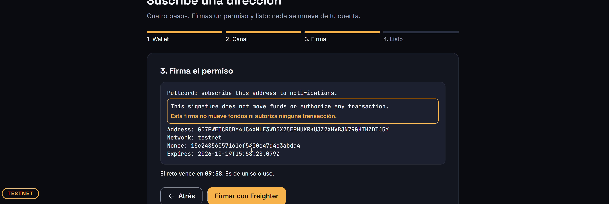
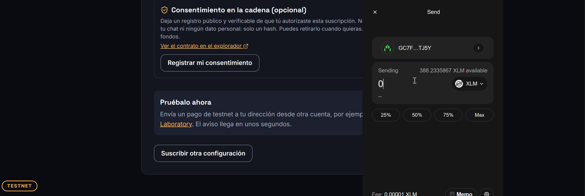
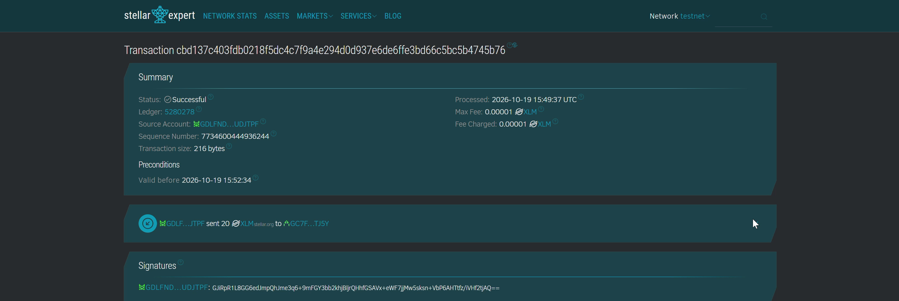
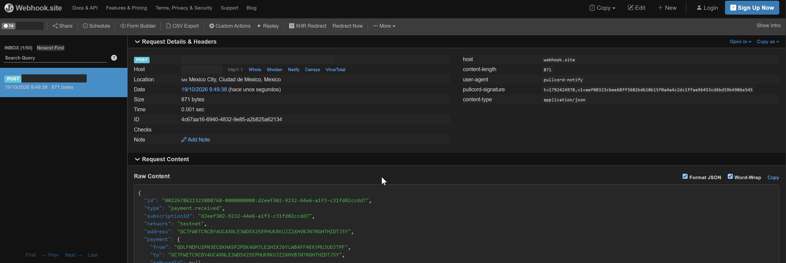

# Pullcord

Capa de notificaciones para apps de Stellar. Tu app integra un paquete chico y
avisa a sus usuarios cuando reciben un pago, por webhook firmado o por
Telegram. Pullcord solo avisa: nunca firma, nunca mueve fondos, nunca ejecuta
nada por el usuario.

Más contexto del proyecto en [docs/PROYECTO.md](docs/PROYECTO.md).

## Demo

- **Video:** https://youtu.be/Zdqvu9tshZI
- **Sitio:** https://www.pullcord.xyz (el front, en Vercel), conectado a la
  API en testnet.
- **API:** https://pullcord-notify.fly.dev (Fly.io, una sola máquina siempre
  encendida, testnet). El sitio le reenvía `/v1` y `/healthz`. Desde el 19 de
  octubre de 2026 el sitio en línea ya responde con la API real
  (`/healthz` y el reto de firma), pero el flujo completo desde el sitio
  (firmar, suscribirse y recibir un aviso) todavía no tiene una prueba
  documentada. La que hay se corrió en local.
- **Contrato de consentimiento (testnet):**
  [`CBAU7N2YV5PHA6LJHFUJKW6J5GFEJAGMYBQFOOEYVJJSQBWV6R7VZJAA`](https://stellar.expert/explorer/testnet/contract/CBAU7N2YV5PHA6LJHFUJKW6J5GFEJAGMYBQFOOEYVJJSQBWV6R7VZJAA)
  en Stellar Expert. Solo existe en testnet.

Capturas del flujo real en testnet, corrido en local, en orden: firmar el
permiso, pagar, confirmar y avisar. El pago fue de 20 XLM. En la última se
taparon la IP y la URL de la bandeja de prueba.









Más evidencia, con hashes de transacción, en
[docs/semana4/MVPFunctional.md](docs/semana4/MVPFunctional.md).

## Estado

**Probado con evidencia**
- Aviso por webhook firmado con HMAC: el pago de testnet de arriba disparó un
  aviso con el encabezado `pullcord-signature`, visible en la captura.
- Consentimiento en cadena con el contrato en testnet: `register` y `revoke`
  confirmados como exitosos (ledgers 5263740 y 5263745, hashes en el
  documento de semana 4). Para direcciones C es obligatorio y para las demás
  es opcional.
- Retiro del consentimiento: al retirarlo en la cadena, el servidor borra la
  suscripción antes de la siguiente entrega. Esto está cubierto por las
  pruebas automáticas (`npm test`) y por la lectura real del contrato.

**Implementado, sin prueba real documentada**
- Canal de Telegram: está en el código, pero no hay captura ni hash de una
  prueba real. Sin `PULLCORD_TELEGRAM_BOT_TOKEN` no se activa.

**Pendiente**
- Correr el flujo completo desde el sitio en línea contra la API en Fly y
  guardar la evidencia (hash del pago y aviso recibido).
- Probar desde el navegador, con Freighter, el registro y el retiro del
  consentimiento, y guardar las capturas. Hoy no hay captura ni video de eso,
  ni de que el aviso deje de llegar después del retiro.
- Publicar `@pullcord/notify` en npm.

## Integrarlo en tu app

El paquete está en [packages/notify](packages/notify/README.md) y se instala
desde este repo con `npm install ./packages/notify`. Hay un ejemplo corto de
suscripción en [examples/subscribe.js](examples/subscribe.js) y uno de cómo
recibir y verificar el webhook en [examples/receiver.js](examples/receiver.js).

## Privacidad

- Fuera de la cadena, el servidor guarda la dirección suscrita y el canal: la
  URL del webhook (con su secreto HMAC) o el chat ID de Telegram.
- En la cadena, solo si registras el consentimiento, quedan tu dirección y un
  hash. Ningún dato personal. Ese registro es público y no se puede borrar.
- Puedes borrar tu suscripción y sus datos cuando quieras con el ID y el
  `manageToken` (`DELETE /v1/subscriptions/:id`, o desde la página de
  gestión). Si retiras el consentimiento en la cadena, el servidor también la
  borra.

## Quién lo construyó

Giovanny Amador ([`Eras256`](https://github.com/Eras256)) y Monserrat Mendoza
([`M0nsxx`](https://github.com/M0nsxx)), en el bootcamp BAF "Blockchain
Builders 101". Demo Day: 26 de octubre de 2026. Detalle de quién hizo qué en
la semana 4 en [docs/semana4/MVPFunctional.md](docs/semana4/MVPFunctional.md).

## Requisitos

- Node.js 22
- Para el contrato: Rust con el target `wasm32v1-none` y la CLI de Stellar 27
  (ver [contracts/consent-registry](contracts/consent-registry/README.md))
- [Freighter](https://www.freighter.app/) en Testnet, con la cuenta fondeada
  por [Friendbot](https://friendbot.stellar.org) (solo para probar el
  frontend)

## Instalación

```sh
npm install
cd frontend && npm install
```

## Cómo correrlo

1. En la raíz del repo:

   ```sh
   PULLCORD_TELEGRAM_BOT_TOKEN=... npm start   # el token es opcional; sin él no hay Telegram
   ```

   La API queda en `http://localhost:8080`. Variables: ver
   [src/config.js](src/config.js). La base de suscripciones es un archivo
   SQLite (`PULLCORD_DB_PATH`, por defecto `pullcord.db`).

2. En `frontend/`:

   ```sh
   npm run dev
   ```

   La página queda en http://localhost:3000 y reenvía `/v1` y `/healthz`
   hacia `:8080` (sin necesidad de CORS).

3. Para probar sin Telegram, suscribe un webhook con
   [webhook.site](https://webhook.site).

4. Pruebas: `npm test` (servidor) y `cargo test -p consent-registry` (contrato).

## Licencia

[Apache License 2.0](LICENSE).
