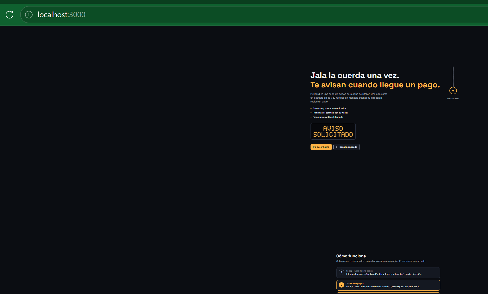
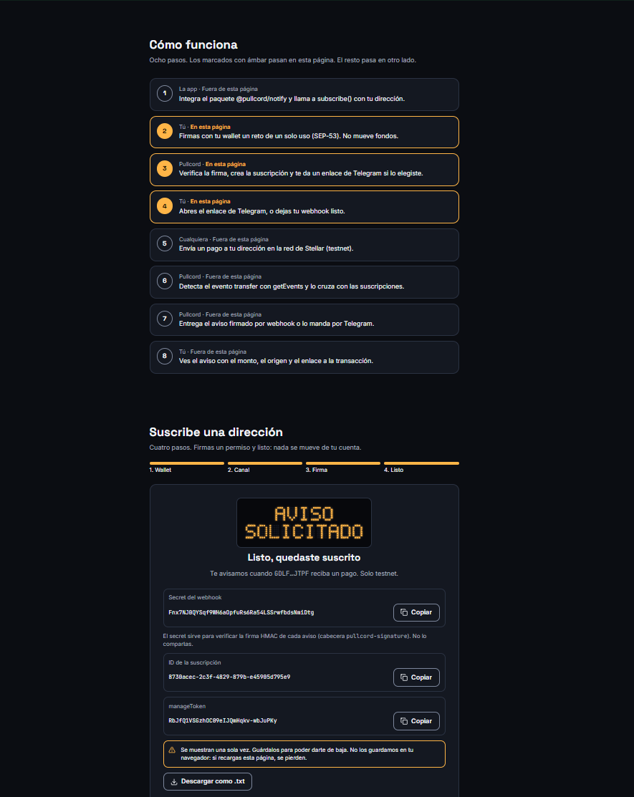
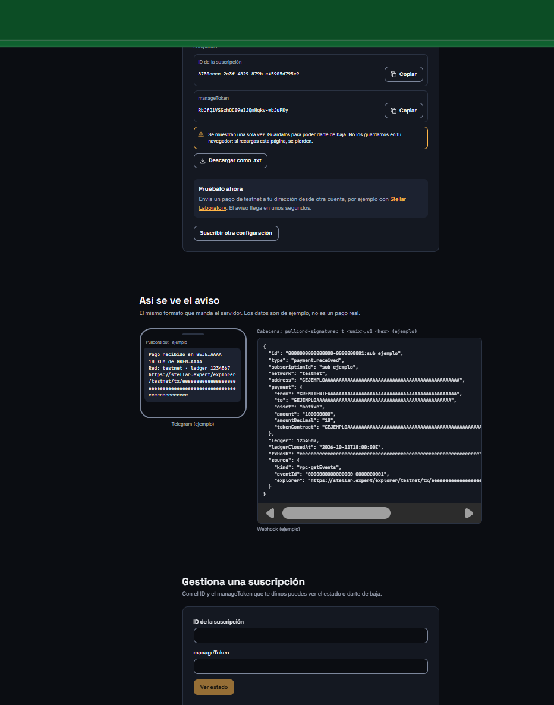
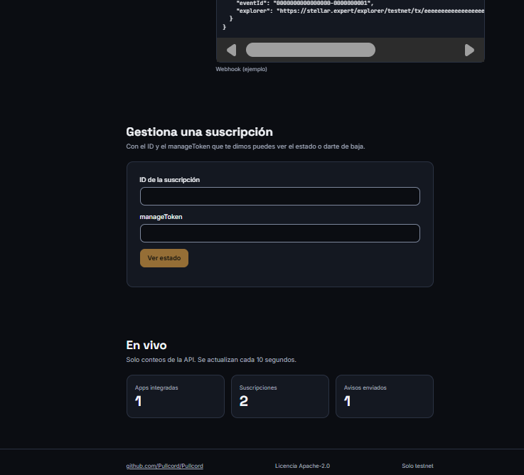
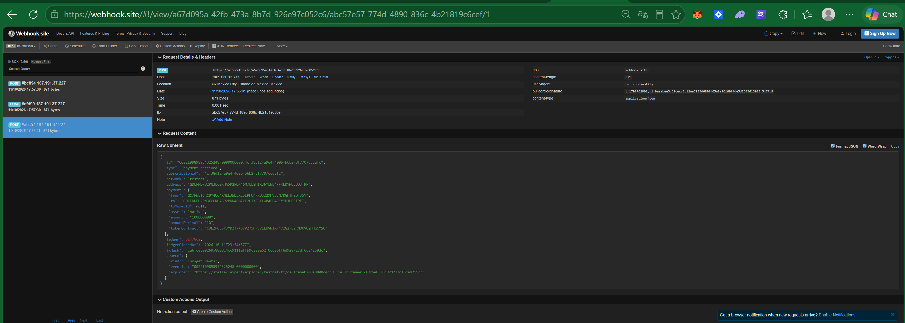

# Documentación - Semana 3: Functional Proof

## Front construido

El front de Pullcord vive en [`frontend/`](../../frontend), fuera de la
carpeta de documentos. Está hecho con Vite, React, TypeScript y Tailwind, y se
conecta a la API que ya existía en [`src/`](../../src). En desarrollo corre en
`http://localhost:3000` y reenvía `/v1` y `/healthz` hacia la API en
`http://localhost:8080`, así que no hace falta configurar CORS. Cómo correrlo
está en el [README](../../README.md). Todo funciona solo en testnet.

### Cómo se conecta con el MVP del Blueprint

El flujo de usuario del Product Blueprint (sección 3) tiene 8 pasos. El front
cubre los pasos donde la persona interactúa directamente con Pullcord: firmar
con su wallet un reto de un solo uso (paso 2), recibir la suscripción creada
por el servidor (paso 3) y dejar listo su canal de aviso (paso 4). El paso 1
(la app integra el paquete `@pullcord/notify`) es código, y los pasos 5 a 8
(el pago en la red, la detección del evento con `getEvents` y la entrega del
aviso) ocurren fuera de la página. La página lo explica con una línea de
tiempo de los 8 pasos que marca en ámbar los que pasan en ella.

### Pantallas y secciones

1. **Inicio.** Frase principal, tres puntos de qué hace Pullcord ("Solo avisa,
   nunca mueve fondos", "Tú firmas el permiso con tu wallet", "Telegram o
   webhook firmado") y la identidad de marca: una cuerda que se jala, como la
   del camión para pedir la parada, y un letrero LED que dice "AVISO
   SOLICITADO". Tiene un botón para ir a suscribirse y un sonido opcional,
   apagado por defecto.
2. **Cómo funciona.** Los 8 pasos del flujo del Blueprint.
3. **Asistente de suscripción en 4 pasos**, con barra de progreso:
   - **Wallet:** conecta Freighter, pide solo la dirección pública y revisa
     que la red sea Testnet.
   - **Canal:** Telegram o webhook. Para el webhook pide una URL https y
     sugiere webhook.site para probar. El nombre de la app es opcional.
   - **Firma:** pide el reto a `POST /v1/subscriptions/challenge`, lo muestra
     completo con la línea "This signature does not move funds or authorize
     any transaction" resaltada, lo firma con Freighter (SEP-53) y crea la
     suscripción con `POST /v1/subscriptions`.
   - **Listo:** muestra el secret del webhook, el id y el manageToken con
     botones para copiar y descargar. Avisa que se muestran una sola vez y no
     los guarda en el navegador. Incluye un bloque "Pruébalo ahora".
4. **Vista previa del aviso.** El formato del mensaje de Telegram y del JSON
   del webhook, tomado del código del servidor, con datos marcados como
   ejemplo.
5. **Gestiona una suscripción.** Con el id y el manageToken se ve el estado o
   se da de baja. La baja borra la URL o el chat ID.
6. **En vivo.** Contadores de `GET /v1/subscriptions/stats` (apps integradas,
   suscripciones y avisos enviados), que se actualizan cada 10 segundos. Son
   solo conteos, sin direcciones ni nombres.

La marca usa una paleta en tokens CSS con modo oscuro y claro. El ámbar se
reserva para la acción principal y para el momento del aviso.

### Prueba de punta a punta en testnet

El 11 de octubre de 2026 se creó una suscripción desde el front con firma real
de Freighter y canal webhook. Después se envió un pago de 10 XLM a la
dirección suscrita y el aviso llegó firmado a webhook.site, con la cabecera
`pullcord-signature` y `type: payment.received`.

- Transacción:
  [`ca6fcebe0260a8808c4cc9111effb9caaee52f0c6e6ff6d929727df6ca4259dc`](https://stellar.expert/explorer/testnet/tx/ca6fcebe0260a8808c4cc9111effb9caaee52f0c6e6ff6d929727df6ca4259dc),
  verificada en Horizon testnet: exitosa, ledger 5147862,
  2026-10-11T23:54:57Z.
- De `GC7FWETCRCBY4UC4XNLE3WD5X25EPHUKRKUJZ2XHVBJN7RGHTHZDTJ5Y` a
  `GDLFNDFU2PN3ECGKHA5P2PDK46M7LE2HIXJ6YLWB4FF4EKYMUJUDJTPF`.
- El aviso corresponde a la suscripción
  `4cf38d12-a9e4-400b-b6b2-8f7707ccdafc`.

### Capturas

1. [Inicio en pantalla ancha](capturas/1-inicio.png). Muestra un bug: en
   ventanas muy anchas el contenido se carga a la derecha en vez de
   centrarse.
2. [Cómo funciona y suscripción lista](capturas/2-suscripcion-lista.png). La
   suscripción de esta captura ya se dio de baja, así que su secret y su
   manageToken ya no sirven.
3. [Vista previa del aviso y gestión](capturas/3-vista-previa-y-gestion.png).
4. [Contadores en vivo](capturas/4-estadisticas-en-vivo.png).
5. [Aviso real recibido en webhook.site](capturas/5-aviso-recibido-webhook.png),
   con la cabecera de firma y el hash de la transacción.

## Decisión técnica

**Opción elegida: A. Contrato propio.**

En el Blueprint, Pullcord usa Stellar para dos cosas: detectar pagos con
Stellar RPC (`getEvents`, eventos `transfer` unificados por CAP-67) y probar
con SEP-53 que la persona controla la dirección que se suscribe. Esa prueba
funciona para direcciones G, pero una dirección C (un contrato) no puede
firmar un mensaje SEP-53. Por eso hoy las direcciones C se aceptan sin prueba
de propiedad y solo en testnet.

El contrato registrará las altas y bajas de consentimiento de monitoreo por
dirección (G o C), firmadas por la wallet que controla esa dirección. No
guardará datos personales en la cadena: ni la URL del webhook ni el chat ID.
Así se cierra el hueco de las direcciones C, y la revocación del
consentimiento queda verificable por cualquiera en la cadena, sin depender de
que Pullcord diga que la procesó. Es la historia de mayor prioridad del
backlog: que nadie pueda suscribir una cuenta sin el consentimiento firmado de
su dueño.

Descartamos la opción B porque no encontramos una herramienta del ecosistema
de Stellar que resuelva un registro de consentimiento revocable y sin datos
personales. Es lógica propia del producto y es lo que lo diferencia de otros
monitores. Donde sí existe una pieza del ecosistema, la usamos: el cobro por
consulta para agentes pasa por el facilitador x402 de Rail402, que ya liquida
pagos en testnet, y la firma se hace con Freighter.

Esta semana no se escribe ni se despliega código del contrato. Eso queda para
la próxima entrega.

## Participación del equipo

- **Monserrat Mendoza** (GitHub: `M0nsxx`): Construí el frontend de Pullcord
  en frontend/ (Vite, React, TypeScript, Tailwind): marca y logo en SVG,
  paleta con modo oscuro y claro, hero con cuerda y letrero LED, asistente de
  4 pasos (Freighter, canal, firma SEP-53 y confirmación) integrado con la
  API, vista previa del aviso, gestión de suscripción y contadores en vivo.
  Trabajé con Claude Code como par de programación.
- **Giovanny Amador** (GitHub: `Eras256`): corregí el arranque de la API en
  Windows, recorté el README y moví el resto a
  [docs/PROYECTO.md](../PROYECTO.md), hice la prueba de punta a punta con
  Freighter en testnet, subí las capturas, integré el frontend a `main` y
  armé esta documentación, con Claude Code como par de programación.

## Bloqueos y siguiente paso

- **Centrado en pantalla ancha:** en ventanas muy anchas el contenido no se
  centra (captura 1). No se arregló a tiempo para esta entrega.
- **Direcciones C sin prueba de consentimiento:** se aceptan solo en testnet
  hasta que exista el contrato.
- **Paquete sin publicar:** `@pullcord/notify` todavía no está en npm.
- **Siguiente paso:** diseñar e implementar en testnet el contrato Soroban de
  registro de consentimiento (altas y bajas firmadas por la wallet, sin datos
  personales en la cadena) y conectarlo a las suscripciones de direcciones C.
